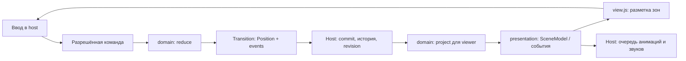

# Архитектура паков ХОД

Текущая связка документации: коллекция **0.8.9**, ХОД **0.21.0**, engineApi 4 / viewApi 3. Старые номера в описании происхождения не меняют текущий контракт.

Карта реализации коллекции **0.8.9** для приложения **0.21.0**: engineApi 4, viewApi 3. Каждый пак — самостоятельная игра с разделёнными правилами, публичным представлением и Web-renderer. Общий host исполняет команды, хранит историю, доставляет сеть, показывает обучение и проигрывает эффекты.

## Файлы и владельцы

```text
packs/<id>/
  manifest.json             метаданные, версии, правила настройки, состав сборки
  manifest.js               генерируемое представление manifest
  rules.js                  связывает definition, presentation, locales с SDK
  domain/game.js            create/validate/actions/reduce/project/result/bot
  domain/*.js               специфичные чистые механики игры
  presentation/scene.js     публичная семантика сцены, команд, событий/кадров
  presentation/tutorial.js  каталог и условия обучения, без сохранения прогресса
  locales/ru/game.json      тексты правил, событий, подсказок и интерфейса
  view.js                   Web-renderer и регистрация обучения
  styles.css                стили пака в его области
  assets/                   ресурсы, если они нужны игре
shared/
  domain/                   чистые общие правила и примитивы
  components/               общие UI-компоненты
  assets/, asset-packs/     каталог, скины и ресурсы
  sounds/, locales/         общие звуки и подписи
  templates/                шаблоны
  pack_compiler.py          подготовка поставляемого контейнера
```

Структура расширяется по сложности игры; не каждому паку нужен отдельный файл для каждой функции. `domain/game.js` Стихий делегирует специализированным модулям; простая игра может оставаться небольшой фабрикой. Смотрите реальные пары [Рыба](../packs/gofish/manifest.json) и [UNO](../packs/uno/manifest.json), затем [Стихии](../packs/mage-brawl/manifest.json).

| Часть | Получает → возвращает | Чего в ней нет |
|---|---|---|
| Domain | Position + actor + command → Transition | DOM, переводов, имён людей, storage, сети, часов окружения |
| `project` | Position + audience → разрешённые данные | Передачи полного состояния гостю ради удобства анимации |
| Presentation | Projection/события → SceneModel/MessageRef/эффекты | Повторного исполнения правил, доступа к закрытым картам authority |
| Tutorial | Публичная сцена + actions + UI/progress → цели/шаги | Записи в localStorage, таймеров курсора, автоматического применения команд |
| Renderer | Подготовленная сцена + actions + UI selection → view API 3 | Вычисления победы/урона/legal moves и собственной истории |
| Locales | MessageRef → текст | Изменения правил в зависимости от языка |
| Shared UI/ассеты | Семантика + skin/palette → элемент | Игровой очереди и сетевых прав |
| Compiler | Manifest и исходные ресурсы → автономный контейнер | Исполнения партии и пользовательских данных |

## Как проходит команда



`rules.js` — адаптер регистрации, а не место хранения игровых правил. В исходном Node-режиме он требует domain/shared модули; подготовленный пакет получает внедрённые compiler зависимости. `manifest.sourceModules.rules` и `.view` перечисляют нужные модули для двух точек входа; presentation может участвовать в обеих. Tutorial включается только в view. `sharedDomain` подключает общие чистые помощники.

Точные сигнатуры Definition/Transition и форма visibility описаны в [SDK приложения](https://github.com/GraphGiraffe/boardgame-playroom/blob/main/docs/SDK-0.18.md). Domain возвращает факты, а не готовую разметку или переведённый текст. Host проверяет контракт и управляет revision/timeline. Не увеличивайте revision самостоятельно из renderer.

## Состояние, выбор и приватность

| Данные | Где живут |
|---|---|
| Карты, поле, здоровье, планы, RNG, результат | Position игры у authority |
| Разрешённые лица, количество чужих карт, события | Audience projection, затем SceneModel |
| Выбранная карта, открытая панель, примерка drag | Host screen `ui.selected` / `ui.viewState` |
| Нормальные правила новой партии | Manifest defaults/settings/presets, затем параметры создания |
| Сложность/стратегия бота | Настройки участника; применяются через runtime |
| Скин, масштаб, звук, освоенные действия | Пользовательские настройки host |
| Очередь перелётов, время звука, текущий кадр истории | Общие presentation/application сервисы host |

Идентичность экземпляра сохраняется при передаче и перестановке: две карты одного ранга не одна карта. Используйте EntityRef, Source/Target и точные IDs. Закрытые рубашки не получают стабильные публичные IDs, связывающие неизвестные карты между руками. Для передачи закрытых карт достаточно зон и количества. См. [COMPONENT-SDK](COMPONENT-SDK.md).

## Presentation, фазы и компоновка

`scene(projection)` описывает участников, метрики, зоны, объекты и взаимодействия. `eventScenes` и публичные кадры конкретных паков задают промежуточные состояния там, где итоговый snapshot опережал бы показ: ответ → передача → появление карт → сбор сета → раскрытие → миниатюра. Метрики и рука должны соответствовать показанному кадру, а не будущему результату.

Host последовательно исполняет группы плана, внутри группы анимация и звук стартуют вместе; окончание ждёт оба. Пауза — отдельный cue. Пак описывает событие/сцену, но не создаёт свой сетевой heartbeat, setTimeout для завершения хода или независимый аудиоплеер. Подробности: [PRESENTATION-PLAYER](https://github.com/GraphGiraffe/boardgame-playroom/blob/main/docs/PRESENTATION-PLAYER.md).

Renderer использует общий набор карт, рук, досок, источников/целей, жетонов и таблиц. Изменение геометрии поля по содержимому запрещено по умолчанию: резервируйте слоты заранее. `allowLayoutChange` — явное исключение для конкретного сценария; viewport/масштаб пересчитываются host. Основные карты не уменьшаются при росте их числа. Размеры и protectedZones скина определяют допустимое перекрытие, не правила игры.

Shared-компоненты редактируются здесь, затем приложение явно синхронизирует закреплённые копии. Для game-specific CSS используйте класс сцены; не меняйте глобально `.button`, `.card` или настройки соседних паков. Подробности и helper-примеры — [AUTHORING](AUTHORING.md), [типы элементов](PIECE-TYPES.md).

## Боты и одновременные решения

`bot` получает projection и доступные команды, разрешённую память и context сложности. Host предоставляет воспроизводимую случайность и общий механизм ошибок; пак задаёт стратегию. При собственной модели ошибки используется `botHandlesDifficulty`; не применяйте одну вероятность повторно и в runtime, и в паке. `botMistakes` ограничивает альтернативы. Три сложности — easy/medium/hard, medium по умолчанию; сложный бот тоже может ошибаться.

Примеры: [Пексесо](../packs/pexeso/domain/game.js) — память/вероятности; [Лудо](../packs/ludo/domain/game.js) — оценка угроз и ходов; [UNO](../packs/uno/domain/game.js) — реакции и `botReactionDelay`. Пак возвращает задержку, часы и жизненный цикл реакции принадлежат authority.

`decisionWindow` описывает разрешённых участников, готовность и версии решений; host не должен сводить такое окно к одному `turn`. Сами закрытые планы остаются в domain до раскрытия. Морской бой разрешает независимую расстановку; Стихии разрешают одновременное планирование. Порядок разрешения конфликтов — правило конкретной игры, а не порядок прихода сетевых сообщений.

## Обучение

`presentation/tutorial.js` задаёт постоянные `goals` и текущие `steps`; `view.js` регистрирует фабрику через `registerTutorial`. ID и revision принадлежат паку. Пользовательские отметки принадлежат приложению и переживают обновление packVersion.

Сценарий должен распознавать реальное действие независимо от способа ввода и не навязывать фиксированную цепочку выбора. Отдельно описывайте вторую карту, выбор цвета, повторный бросок, действия союзной фишкой, поворот/справку, возрождение. Не включайте автоматический добор или автопереключение поля как нажатие пользователя. Полный контракт и порядок добавления цели — [TUTORIALS приложения](https://github.com/GraphGiraffe/boardgame-playroom/blob/main/docs/TUTORIALS.md).

## Сборка и версии

`manifest.json` — источник версии и состава; `manifest.js` генерируется. Compiler собирает domain/presentation/locales в точки входа и не сохраняет потреблённые исходники второй runtime-копией. Авторские `.md/.txt` не поставляются как игровые ассеты. Общие ресурсы разных автономных паков могут повторяться — это не повод ломать независимость установки. Одинаковые файлы внутри одного пака требуют проверки фактического использования; рубашки разных скинов могут быть намеренно одинаковыми.

`version` меняется при изменении поставляемого пака; `stateVersion` описывает формат сохранённого состояния; `engineApi/viewApi` — совместимость с host. Эти числа не взаимозаменяемы. Сохранения закреплены за точной packVersion, новая установка не переписывает старое состояние. Самостоятельный контейнер не должен требовать runtime-доступа к соседнему checkout или CDN.

## Где менять и как проверять

| Изменение | Затрагивает | Основная проверка |
|---|---|---|
| Новая команда/механика | domain → projection → presentation → view/locales | Legal/illegal команды, детерминизм, privacy, replay |
| Новая метрика | domain result + presentation metrics + locale | Значение и момент показа; стандартная панель host |
| Новый эффект | Событие/публичная сцена; при необходимости shared host effect | Последовательность, звук, отмена, history |
| Новая настройка правил | manifest settings + domain create/validate + правила | Default, сохранение/загрузка, допустимые значения |
| Новая цель обучения | tutorial + locales + sourceModules.view | Альтернативный ввод, редкий этап, обновление revision |
| Новый skin/элемент | shared assets/components + manifest | Геометрия, светлая/тёмная тема, privacy, сборка |

Начните с двух реальных примеров нужного конструкта; `examples/private-counter` демонстрирует минимальную проекцию, [presentation-contracts](../examples/presentation-contracts/README.md) — компоненты/эффекты. Полные игры демонстрируют связку слоёв, но их UI-разметку не следует копировать целиком в новый пак.

Синтаксис/контейнер проверяет `bash scripts/codex/check.sh` из корня коллекции. Игровые и браузерные сценарии находятся в companion-приложении: сначала подготовьте точную коллекцию через `--packs-dir`, затем выберите затронутые тесты. Команды и процессы — [политика utils](https://github.com/GraphGiraffe/boardgame-playroom-utils/blob/main/docs/VALIDATION-POLICY.md). Один и тот же совместный прогон не нужно дублировать в обоих репозиториях.

## Compact public frame sequences

`shared/domain/frame-sequence.js` provides pure `PlayroomFrameSequence.encode(frames)` / `expand(sequence)`. Include `frame-sequence` in `sharedDomain`. The format is `{format:1,base,deltas}`: the first authorized public frame followed by bounded object/indexed-array changes. Deltas represent already resolved public facts, never full authority states, private plans, physical card IDs or RNG. Limits: 256 frames, 4096 operations per delta, path depth 32, bounded input structure. Mutable input is detached; cached identities are reused only after recursive immutability is established. Expansion preserves frame ordering and produces immutable public frames with shared unchanged descendants.

Mage projects `frameSequence`, not repeated `frames`; presentation expands it locally to the same phase plan. The internal rules/history retain their original resolved frames. Private route preview resolves identical physics but records only the motion facts it consumes. Shared modules are bundled after presentation factory declarations: look up their APIs when presenting, rather than capturing an uninitialized scope value at factory creation. No game ID branches are required in the application.

Игровой пример команд, дополнительных жизней и сжатия: [Стихийная потасовка](MAGE-BRAWL.md). Увеличение версии manifest не изменяет исходники правил; source и архивы ранее опубликованных версий сохраняются отдельно.
